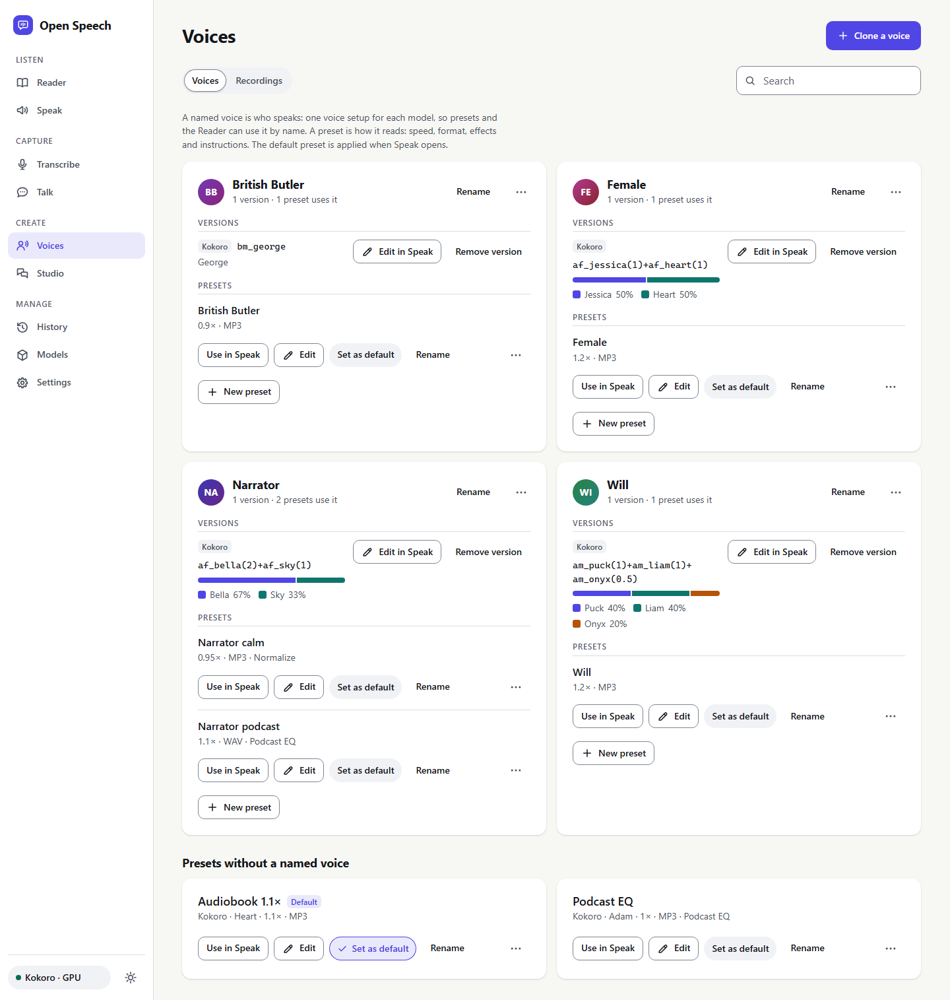

# Named voices and reading presets

Named voices separate a voice's identity from the settings used to read with it.

- A **named voice** has a stable UUID and a name, such as Narrator.
- A **realization** (a **version** in the web UI) specifies exactly one model, its provider voice
  or blend, and an optional saved reference recording. A voice can have one realization per exact
  model.
- A **reading preset** selects a voice/model and stores speed, effects, delivery
  instructions, and output format. Existing `/api/profiles` endpoints remain the preset API.

Having a Kokoro realization does not create a Qwen or Chatterbox clone. Adding another
realization is explicit, and using the same recording does not establish acoustic similarity.
The selected model must exist and support its controls; no provider or voice is substituted.

## Use in the web UI

1. In **Speak**, choose the exact model, then a voice in the voice picker, a blend, or a
   **Reference recording** for a cloning model. **Use in Speak** on a card in **Voices ›
   Recordings** brings an existing recording.
2. Choose **Save named voice…**. Enter a new name, or an existing voice's name to add a version
   for another model or, after confirmation, to update this model's version.
**Voices** shows named voices and presets in one list: a named voice is who speaks (one version
per model), a preset is how it reads (speed, effects, instructions and format).

3. On the voice's card in **Voices**, choose **New preset**. Speak opens with that voice, on the
   model it is on when the voice has a version for it, else on the voice's first model that has
   one, with **Save preset…** focused. (Or pick the voice in the voice picker's **Named voices**
   group.)
4. Set speed, effects, instructions, and format, then choose **Save preset…**; its name starts as
   the voice's. Multiple presets can use the same named voice; the preset chips in Speak apply
   them.

Each named voice's card lists its model versions and, under them, its presets. **Edit in Speak**
loads a version into Speak with an editing bar, "Editing Narrator for Kokoro": **Update voice**
saves the version without asking the name again, and the presets that use it follow; **Cancel**
puts Speak back as it was; choosing another model ends the editing. **Remove version** removes
one model's version; **Rename**, or the card's menu, renames the voice, and the menu deletes it.
Updates apply to linked presets without changing their reading controls. Removal keeps those
presets as standalone recipes and preserves recordings. Each preset has **Use in Speak**,
**Edit** (Speak applies it with "Editing preset “Podcast”": **Update preset** saves Speak's setup
into it, **Save as new…** saves it as another preset, **Cancel** goes back), **Set as default**,
**Rename** and Delete…. Presets that use a provider voice, a blend or a recording directly are
listed under **Presets without a named voice**. The default preset is marked wherever it sits.



Changing the provider voice, blend, or reference detaches the named-voice selection.
Changing speed or effects changes the reading recipe. Voices without a usable realization
remain visible but disabled for the selected model. Offline providers and missing references
retain their identity and realization records.

Speak, Live Reader, and Conversation resolve the exact model's realization. Conversation
also honors legacy blend strings, preset effects followed by turn effects, and instructions.
Missing saved conversation presets fail rather than falling back to the configured voice.
Effects are supported by complete HTTP synthesis and Conversation; Live Reader does not apply
effects, so Speak hides them in Live mode. Its model capabilities still determine whether it
supports a given voice.
Both skip effects when `OS_EFFECTS_ENABLED=false`, and refuse an effect parameter they cannot
apply with HTTP 400 before any synthesis. Conversation renders speak the `TTS_PRONUNCIATION_DICT`
replacements; the stored turn text is unchanged.

## API

| Method | Path | Purpose |
| --- | --- | --- |
| POST | `/api/voices/identities` | Create a named voice with `name` |
| GET | `/api/voices/identities?model=kokoro` | List identities and realization availability |
| GET | `/api/voices/identities?check_availability=false` | List saved voices without contacting providers |
| PATCH/DELETE | `/api/voices/identities/{id}` | Rename or remove an identity |
| POST | `/api/voices/identities/{id}/realizations` | Add `model`, `voice`, optional `reference_audio_id` |
| PUT/DELETE | `/api/voices/identities/{id}/realizations/{model}` | Update or remove an exact model version |
| POST/PUT | `/api/profiles[/{id}]` | Save a reading recipe (`speed` 0.25–4.0, `422` otherwise); optional `voice_identity_id` and `instructions` |
| GET | `/api/profiles/{id}/resolve` | Resolve a preset's exact voice recipe |

Use the returned `voice` string (`voice:<UUID>`) with the ordinary speech request:

```json
{
  "model": "kokoro",
  "voice": "voice:<UUID returned by the identity API>",
  "input": "A short reading sample.",
  "speed": 1.2,
  "response_format": "wav"
}
```

The UUID is case-insensitive. The same string is accepted in Live Reader's `session.update`.
HTTP synthesis resolves the selected model's voice and stored reference before validating
controls or using the cache. Inline reference audio, design prompts, and replacement clone
transcripts cannot override a named voice (HTTP 400). An unknown named voice returns 404; a
voice with no realization for the requested model returns 400. Live Reader answers both with
an `invalid_event` error. Clone requests remain excluded from the shared output cache.
A request logged to history (`X-History: true`) records the resolved provider voice, and its
`meta.reference_voice` records the stored reference, as `GET /api/history` returns them.

These identity endpoints and voice IDs are Open Speech extensions. They do not implement
OpenAI's custom-voice creation or consent APIs.

## Existing installations

Startup adds tables and two profile columns to the existing Studio database. The one-time
migration links legacy profiles to named voices using their existing name and exact model.
Profile IDs, defaults, original blends, reference names, effects, speed, and timestamps remain
intact. Recordings are neither rewritten nor copied. Conflicting case variants with different
recipes remain standalone rather than overwriting a realization.

Default recipes and `TTS_VOICES_CONFIG` YAML templates are imported once into the same preset
catalog. Mapping-style YAML from `voice-presets.example.yml` and list-style YAML both work.
An entry without a name or a voice is skipped with a startup warning; a file with entries but
none usable falls back to the default recipes. An entry with a value the API would refuse
(`POST /api/profiles`), such as a blank or out-of-range `speed`, a null `format`, or `effects` that
aren't a list of valid effects, is skipped too: its warning names the entry and the field, and the
entry is imported once the file is fixed. Existing recipes with matching names take
precedence. Deleting an imported preset does not recreate it at the next startup. Later YAML
edits do not overwrite an imported user preset.
`/api/voice-presets` and `/api/profiles` now list the same persistent recipes.

Older clients can keep using provider voice strings and profile fields. Updating a linked
profile's voice/model/reference without an explicit identity ID detaches it into a standalone
recipe; changing only reading settings preserves the link.

## Speech formats and streaming

The [official speech API reference](https://developers.openai.com/api/reference/python/resources/audio/subresources/speech/methods/create)
defines `model`, `input`, `voice`, `instructions`, `response_format`, `speed`, and `stream_format`.
The [text-to-speech guide](https://developers.openai.com/api/docs/guides/text-to-speech) describes
the SDK streaming reader and raw 24 kHz, signed 16-bit little-endian PCM contract.

Open Speech accepts string voices and objects with `id`. A named-voice UUID in an object resolves
its explicit realization for the requested model. `stream_format: audio` streams audio bytes;
`stream_format: sse` emits base64 `speech.audio.delta` events followed by `speech.audio.done`,
or by an `error` event when synthesis fails after the stream has started.
The existing `?stream=true` extension remains supported. Speech PCM is resampled to 24 kHz;
provider-native rates remain available for WAV and internal audio processing.

With `TTS_CACHE_ENABLED=true`, a complete (not streamed) request without effects, instructions,
voice design, a clone transcript, or reference audio is cached on disk; `?cache=false` skips the
cache for one request. The key covers the spoken text after SSML and the pronunciation
dictionary, the resolved voice, speed, format, model, language, and the `TTS_TRIM_SILENCE` and
`TTS_NORMALIZE_OUTPUT` settings, so changing either setting misses the old entries. PCM entries
hold 24 kHz audio whatever the model's native rate. HTTP speech and Wyoming share one cache
per `TTS_CACHE_DIR`: Wyoming stores its replies as 24 kHz PCM entries
and reuses `/v1/audio/speech` PCM entries for the same text, voice, and model at speed 1.0
with no language hint, and the other way round.

Local providers do not expose OpenAI token usage counts, so the SSE terminal event omits usage.
